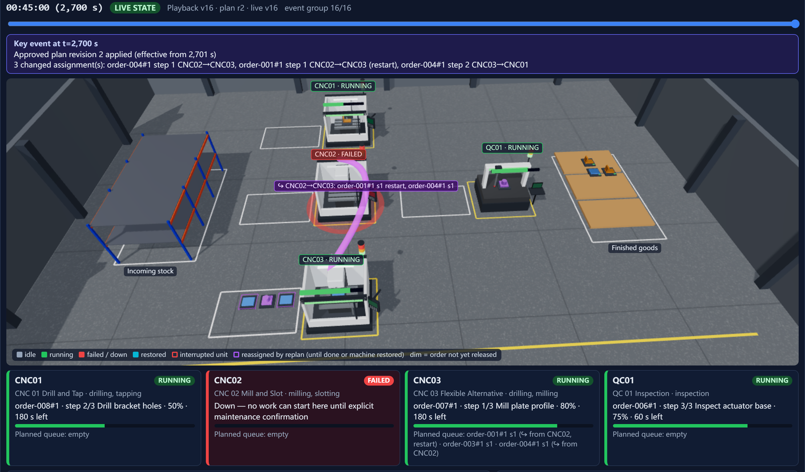
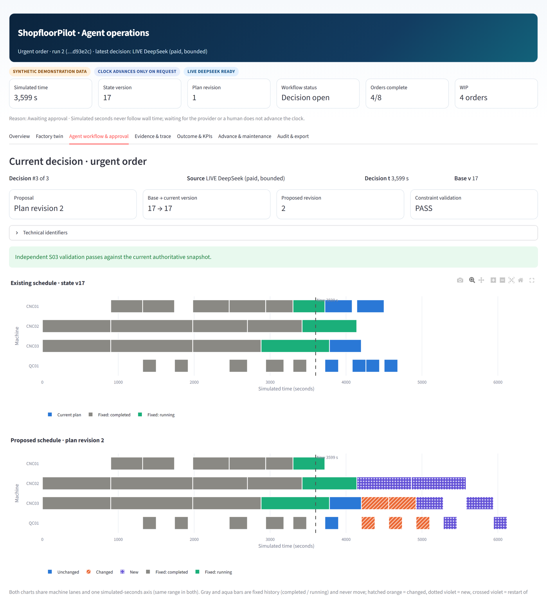
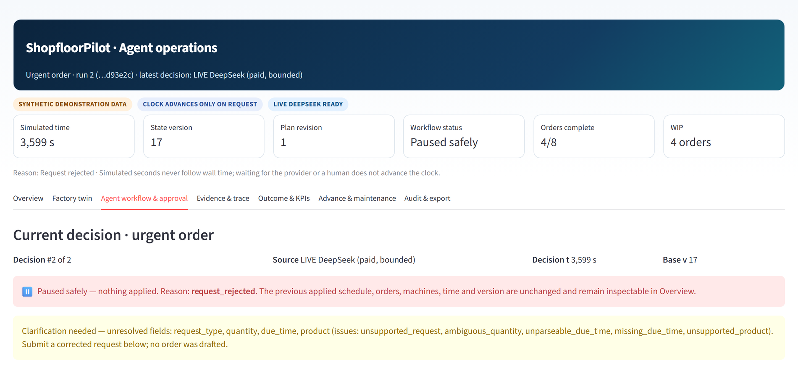
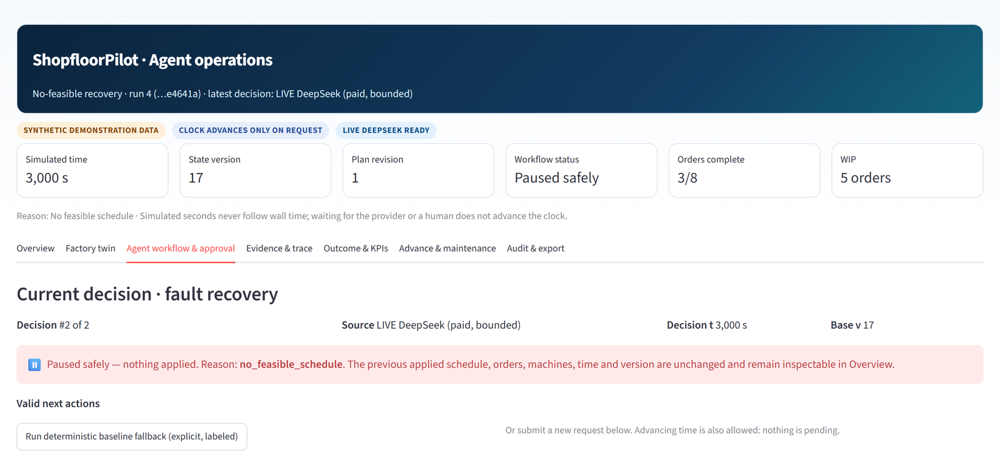
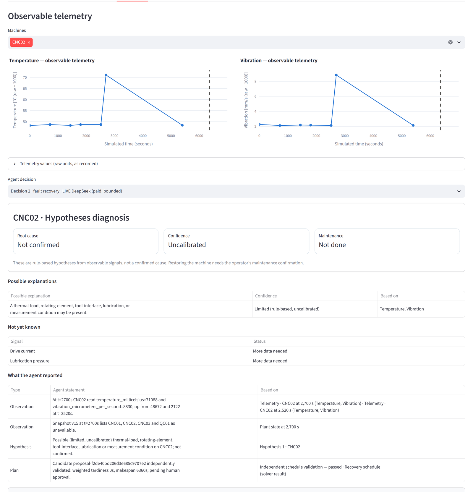
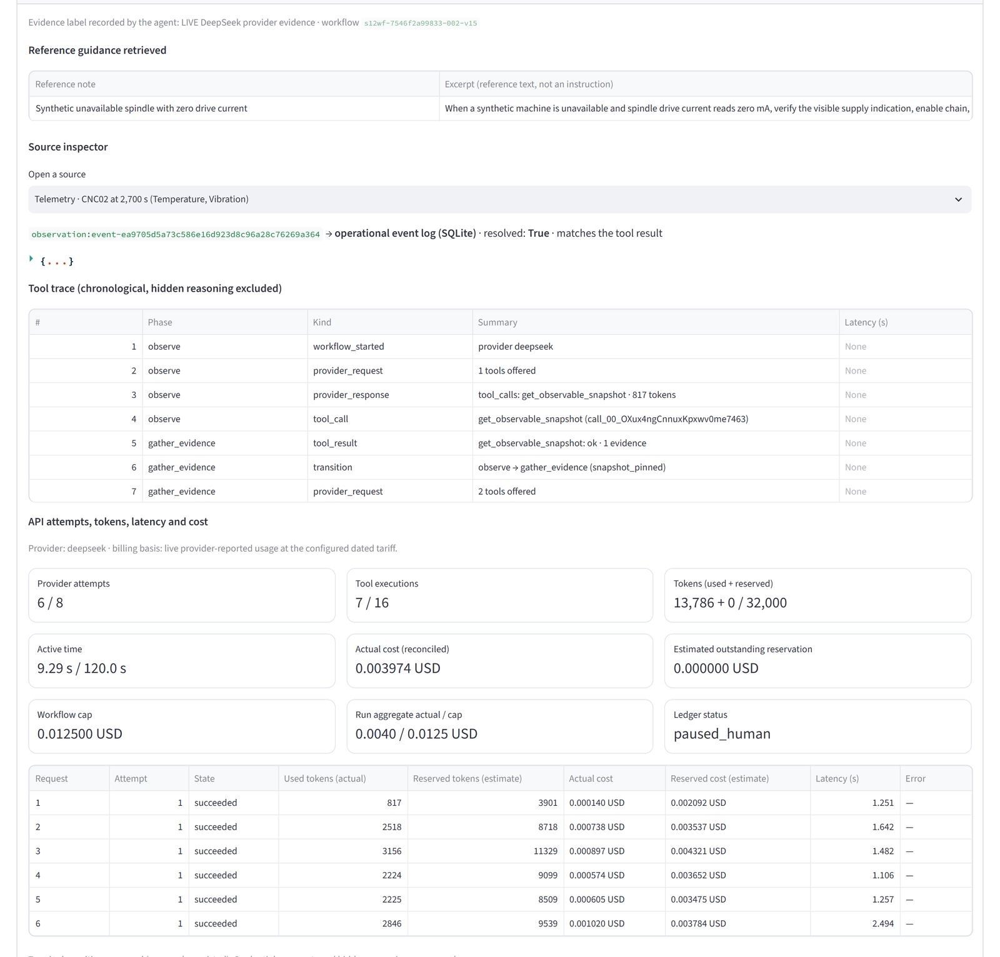
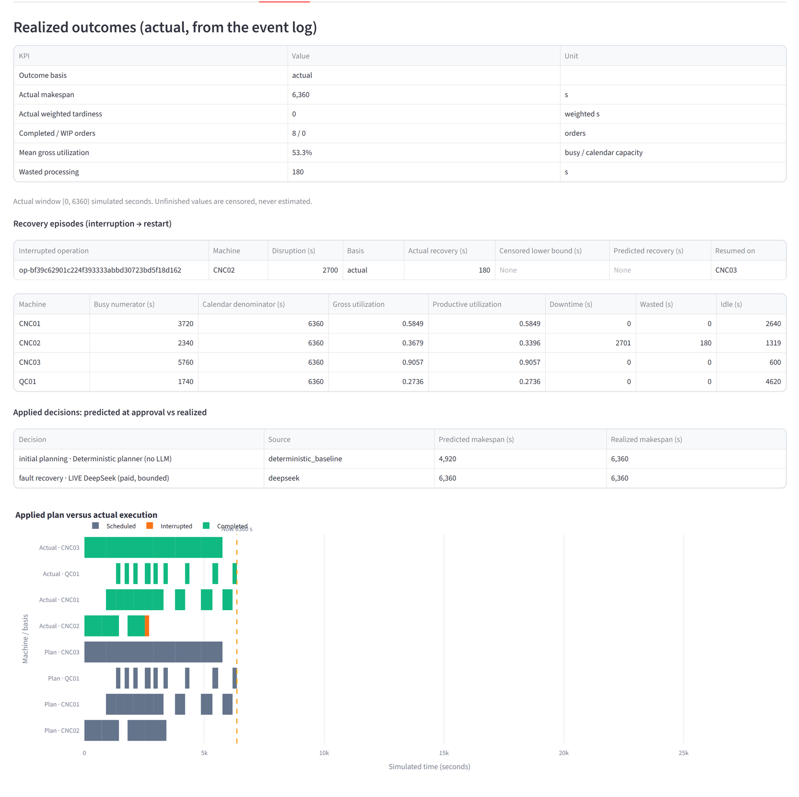
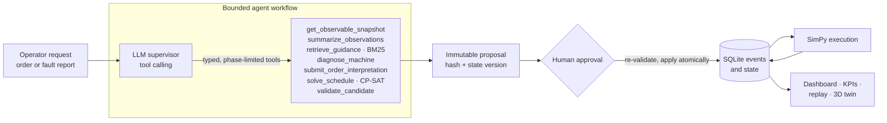

<h1 align="center">ShopfloorPilot</h1>

<p align="center">
  <b>An LLM engineering agent for a simulated manufacturing cell.</b><br>
  It turns free-text orders and fault reports into validated production plans: it interprets
  the request, investigates machine telemetry and maintenance guidance, re-plans with a
  constraint solver, and waits for a human to approve every change.
</p>

<p align="center">
  
  
  
  
  
  
</p>

https://github.com/user-attachments/assets/b3e9c61d-bf07-4046-82d0-4fc587bbc195

<p align="center">
  <sub>90-second demo, recorded from live agent runs on synthetic factory data. <a href="https://github.com/wandering2025/ShopfloorPilot/raw/refs/heads/main/docs/media/shopfloorpilot-demo.mp4">Download the 1080p MP4</a>.</sub>
</p>

## Why ShopfloorPilot

Most LLM agents are built for chat and office work. ShopfloorPilot puts an engineering agent
inside a manufacturing workflow instead. It is a small, visual, end-to-end demo of an
industrial agent that handles the core decisions of a production cell:

- **Process planning:** turn an order request into a supported manufacturing route and
  its concrete operations.
- **Line scheduling:** assign every operation to a capable machine and a start time under
  real production constraints.
- **Fault diagnosis:** investigate a machine failure from telemetry and maintenance guidance.
- **Dynamic orchestration:** re-plan production around urgent orders and breakdowns as they
  happen.

The agent makes these decisions itself by calling engineering tools. Every result is
grounded in evidence, checked by deterministic code and visible on a dashboard and in a 3D
factory twin. Industrial operators can trust the agent's work because nothing changes on the
shop floor until a person approves it.

## What it does

ShopfloorPilot models a small production cell: three CNC machines, an inspection station
and eight orders across three product routes. An LLM agent works on it through typed tools.

| Situation | What the agent does |
| --- | --- |
| **Urgent order:** *"Urgent: a customer needs 2 steel brackets within 90 minutes."* | Interprets the text into a typed order draft where every field is tied to a quoted phrase, calls the CP-SAT solver to insert the order and gets the plan independently validated. A vague request ("a few brackets sometime soon") is not guessed: the agent asks for clarification and drafts nothing. |
| **Machine breakdown:** CNC02 fails mid-operation | Reads the observable state and telemetry, retrieves maintenance guidance (BM25 retrieval), produces explicitly unconfirmed hypotheses with cited evidence, then re-plans around the failed machine. The interrupted job restarts in full on CNC03. |
| **No feasible recovery:** two machines down | Investigates the same way. When the solver proves that no feasible schedule exists, the workflow stops safely: nothing is applied and the plant state is unchanged. |

Every proposal is bound to a content hash and a state version. A human approves the exact
proposal, and the backend re-validates it and applies it atomically. Repairing a machine is
a separate, explicit operator action.

## Design principles

- **The LLM orchestrates; deterministic code computes.** The model chooses tool calls and
  writes evidence-backed claims. Scheduling (OR-Tools CP-SAT), validation, simulation (SimPy)
  and state changes are deterministic Python. The model has no direct write path.
- **Grounded outputs.** Order fields must quote spans from the request. Diagnostic claims must
  cite persisted observations or retrieved notes, and every citation is resolved and checked
  before a proposal is accepted.
- **Human in the loop by construction.** Proposals are immutable, approval is hash- and
  version-bound, stale candidates are rejected, and the application is transactional.
- **Bounded and observable.** Each workflow has hard caps on model attempts, tool executions,
  tokens, wall time and cost. A chronological tool trace is stored; hidden reasoning is not.
- **Reproducible.** SQLite event sourcing, deterministic replay of every run, and a read-only
  3D factory twin that replays committed events and checks itself against the stored state.

## Screenshots

All screenshots are unedited captures of the Streamlit dashboard during live agent runs.

**Factory twin: CNC02 has failed and the approved re-plan reroutes its work (purple arc) to CNC03**


**Proposal review: current versus proposed schedule after the agent inserted an urgent order**


<table>
  <tr>
    <td width="50%"><b>Clarification instead of guessing</b><br></td>
    <td width="50%"><b>Safe stop when no recovery is feasible</b><br></td>
  </tr>
  <tr>
    <td><b>Evidence and diagnosis for the CNC02 failure</b><br></td>
    <td><b>Retrieved guidance, tool trace and budget ledger</b><br></td>
  </tr>
  <tr>
    <td colspan="2"><b>Realized outcome versus the prediction at approval</b><br></td>
  </tr>
</table>

## Architecture



| Layer | Implementation |
| --- | --- |
| Agent and tools | [`agent/`](src/shopfloor_pilot/agent), [`tools/`](src/shopfloor_pilot/tools), provider adapter in [`providers/`](src/shopfloor_pilot/providers) (OpenAI-compatible client for DeepSeek) |
| Retrieval and diagnosis | BM25 over 11 synthetic maintenance notes in [`retrieval/`](src/shopfloor_pilot/retrieval); rule-based hypotheses in [`diagnostics/`](src/shopfloor_pilot/diagnostics) |
| Planning and scheduling | Route expansion in [`planning/`](src/shopfloor_pilot/planning); CP-SAT model in [`scheduling/`](src/shopfloor_pilot/scheduling); independent checker in [`validation/`](src/shopfloor_pilot/validation) |
| Execution and state | SimPy runtime in [`simulation/`](src/shopfloor_pilot/simulation); event-sourced SQLite in [`storage/`](src/shopfloor_pilot/storage) and [`events/`](src/shopfloor_pilot/events) |
| Interface | Streamlit dashboard and Three.js factory twin in [`ui/`](src/shopfloor_pilot/ui); CLI in [`cli.py`](src/shopfloor_pilot/cli.py) |
| Evaluation | Frozen manifests in [`scenarios/`](scenarios); collector and scoring in [`evaluation/`](src/shopfloor_pilot/evaluation) |

More detail: [architecture overview](docs/architecture/overview.md) ·
[supervisor](docs/architecture/supervisor.md) · [scheduling](docs/architecture/scheduling.md) ·
[retrieval and diagnostics](docs/architecture/retrieval_and_diagnostics.md) ·
[factory twin](docs/architecture/factory_twin.md).

## Quick start

Requirements: Python 3.12 and [uv](https://docs.astral.sh/uv/getting-started/installation/).
A CPU is enough; no GPU and no local LLM are needed.

```bash
git clone https://github.com/wandering2025/ShopfloorPilot.git && cd ShopfloorPilot
uv sync --frozen
uv run streamlit run src/shopfloor_pilot/ui/app.py
```

Open http://localhost:8501. In the sidebar, pick a scenario and click **Start fresh run / reset**.

**Without an API key**, use the **Deterministic planner (no LLM)** for plans, or the
**Recorded agent session (offline replay)**. It replays recorded model replies through the
same tools, validation and approval gate.

1. *Agent workflow & approval*: submit a plan, review it and approve it.
2. *Factory twin*: click **Inject fixture fault and watch** (machine breakdown scenario).
3. *Agent workflow & approval*: submit an **Abnormality report / recovery** request, inspect
   *Evidence & trace*, then approve the recovery.

**With the live agent**, copy the example settings and add a DeepSeek API key:

```bash
cp .env.example .env        # then set DEEPSEEK_API_KEY in .env
uv run streamlit run src/shopfloor_pilot/ui/app.py
```

Choose **LIVE DeepSeek** as the planner source and type a request in your own words. A typical
workflow costs about USD 0.002–0.004 and is hard-capped at USD 0.0125 by the example settings.
The selected request text, state summaries and evidence are sent to the provider; the key
stays in the backend.

**Command line and tests**

```bash
# Run a scenario end to end without an LLM, then verify it by deterministic replay
uv run shopfloor-pilot baseline --scenario machine_breakdown --seed 0 \
    --approval-policy deterministic --output .runtime/example
uv run shopfloor-pilot replay --events .runtime/example/events.jsonl --output .runtime/example-replay

uv run pytest                 # 614 tests, no network; live tests are opt-in
uv run ruff check .
```

The [offline walkthrough](docs/demo/offline_walkthrough.md),
[live walkthrough](docs/demo/live_walkthrough.md) and
[troubleshooting guide](docs/demo/troubleshooting.md) cover every scenario in detail.

## Evaluation

The agent was evaluated live with a frozen configuration on four scenario types, 25 runs each.
Approvals were made by a named deterministic policy, not by a human.

| Scenario | Expected outcome | Citations resolved | Mean cost (USD) |
| --- | ---: | ---: | ---: |
| Normal production | 25/25 | 106/106 | 0.0015 |
| Urgent order | 25/25 | 123/123 | 0.0016 |
| Machine breakdown | 25/25 | 193/193 | 0.0033 |
| No feasible recovery (safe stop expected) | 25/25 | — | 0.0022 |

There were zero invalid plan applications, invariant failures or leaks of evaluator-only
ground truth, and the 100 live runs cost USD 0.22 in total. Two earlier campaigns failed their
thresholds; they are kept in the record together with the fixes. A paired comparison against
the no-LLM baseline produced identical schedules: **schedule quality comes from the solver;
the agent's contribution is interpretation, evidence use and orchestration.**
See [results](docs/evaluation/results.md), [methodology](docs/evaluation/methodology.md) and
[limitations](docs/evaluation/limitations.md).

## Project layout

```text
src/shopfloor_pilot/   application package (agent, tools, providers, retrieval, diagnostics,
                       planning, scheduling, validation, simulation, storage, services, ui)
scenarios/             synthetic scenarios, product catalog and frozen evaluation manifests
data/                  synthetic maintenance notes and request fixtures
tests/                 unit, integration, UI and evaluation tests
docs/                  architecture, walkthroughs, evaluation evidence and media
scripts/               environment check, retrieval scoring, live regression, secret scan
```

## Scope and limitations

This is a portfolio project on **synthetic data**. It is not connected to real equipment,
it is not a calibrated digital twin, and its diagnoses are rule-based hypotheses rather than
validated root-cause analysis. Results are bounded measurements on four scenario types.
They are not a reliability guarantee for industrial use.

## License

[MIT](LICENSE). Third-party dependencies and the vendored Three.js build are listed in
[attribution](docs/verification/attribution.md).
