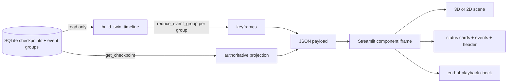

# Factory twin view (visual digital-twin prototype)

Status: S15 architecture decision record. Schema: `shopfloor_pilot.factory_twin/1`.

The **Factory twin** dashboard tab shows the four catalog machines, the order units
moving through them, running operations, failures, interruptions, restorations and
changed machine assignments after an approved replan. It is a portfolio-scale
*visual prototype*: a read-only projection of the authoritative SQLite event stream,
not a calibrated physical model, an industrial digital twin or a control surface.

## Decision

| Choice | Reason | Rejected alternatives |
| --- | --- | --- |
| Three.js 0.186.1, vendored unchanged, inside a no-build Streamlit v1 component (`components.declare_component(path=...)`) | Open source (MIT), lightweight, served by the local Streamlit server; no CDN, Node.js or bundler needed | Game engine / digital-twin platform (scope, weight); Plotly 3D (no practical per-object animation); `components.html` (re-sends a ~2 MB inline bundle on every rerun); CDN scripts (not locally hosted) |
| Pure Python timeline builder (`ui/factory_twin.py`) using the existing `reduce_event_group` | Reuses the replay reducer, so the view is derived from exactly what SQLite committed | A second state model in JavaScript; reading telemetry or scenario files |
| Display-only component | It never sends `streamlit:setComponentValue`, never requests the network and has no write path | A bidirectional widget (would add an action path and reruns) |
| One JavaScript playback clock | Scene, machine cards, event list and header render from one derived object in the same animation frame | Streamlit-native cards (would need a rerun per playback tick and could drift) |
| Canvas-2D renderer with the same interface | Automatic fallback when WebGL is unavailable, and an operator choice that needs no WebGL/GPU context | WebGL only |

## Data flow and authority

`build_twin_timeline_from_repository(repository, run_id, catalog, state_version=v)`
reads the version-zero checkpoint, the persisted envelopes up to checkpoint `v` and
that checkpoint itself. It reduces **every committed event group** in order with the
existing pure reducer. Each group that contains a business fact becomes a keyframe;
groups that only advance the clock or record telemetry are folded into the
interpolation between keyframes (the final group is always kept). The dashboard
caches the payload by `(database, run, state version)`; committed history is
append-only, so that key fully determines the result.

The builder also verifies, before anything is rendered:

1. the replayed final snapshot hash equals the stored checkpoint hash; and
2. `project_snapshot(replayed)` equals `project_snapshot(stored)`.

A replay error raises `TwinTimelineError` and the tab shows an error instead of a
guess. If either check fails, the tab **fails closed**: it shows the mismatch and
does not render the component at all, so no animation of an unverified stream is
shown (`test_a05_dashboard_refuses_to_render_an_unverified_stream`).

Operator buttons on the tab (**Advance and watch**, **Run plan to completion and
watch**, **Continue production without … and watch**, **Inject fixture fault and
watch**, **Confirm … maintenance complete**) are
ordinary Streamlit buttons that
call the same controller/workbench methods as **Advance & maintenance**, with the
same open-decision guard. Both plan buttons are refused by the backend
(`plan_needs_recovery`) and disabled in the view while the applied plan cannot run as
it stands — work scheduled on a down/maintenance machine, or an interrupted operation
without a scheduled restart — so they never skip the recovery decision. **Run plan to completion** advances to the applied
schedule's last planned completion (latest scheduled window end or running attempt
end), so a recovered plan can be watched in one piece; playback speed is never changed
per segment, so segments keep their true proportions. **Continue production without …** advances,
while the machine stays down, by the recorded length of the normal segment (first
applied plan to the latest fault), capped at the plan's last planned completion, so
the degraded line can be watched as long as normal production was. Plans are still proposed, reviewed and approved only in
**Agent workflow & approval**; the view cannot approve, apply or restore anything.

## What is modeled and what is a visual convention

Derived from the snapshot after each committed group (facts):

| Visual | Source |
| --- | --- |
| Machine status: idle, running, failed (`down`), maintenance | `Machine.status` and running attempts |
| Restored badge | a `machine_restored` event, until the machine next starts work or goes down |
| Running operation, attempt number, progress bar | running attempt: `(t − actual_start) ÷ planned_duration` |
| Unit zone: incoming (unplanned), queue at machine *M*, on machine, held (interrupted), finished | operation/attempt statuses and the next scheduled attempt's machine |
| Queue order | scheduled start of each unit's next attempt |
| Interrupted unit and wasted seconds | `operation_interrupted` and the attempt's `consumed_seconds` |
| Reassignment arc, arc label and "↪ from M" badge | next-attempt machine before vs after a `plan_applied` group; kept while the operation is queued, running (including a full-duration restart) or held, until that operation completes **or** every machine that was down when the plan was applied has been restored (`machine_restored`) |
| Restart marker | `restart_of_attempt_id` on the scheduled attempt |
| Dimmed unit | playback time is before the order's release time |

Visual conventions (not manufacturing facts): floor coordinates, the incoming and
finished areas, queue lanes, and the short animated movement between zones.
**Transport between stations is not modeled**; a moved unit changed zone at a
committed boundary, and the tween only makes that readable. Telemetry,
diagnostics, evaluator-only truth and future interventions are not part of the
payload (a test checks this).

Progress interpolation is exact, not an estimate: an operation completes only at a
committed boundary, so no completion can fall strictly between two keyframes
(also tested).

## Playback and synchronization

Playback time is `(frame index, simulated seconds)`. Speeds are 15–1200 simulated
seconds per wall second (default 120×). Options: hold at key events (failure,
interruption, plan application, restoration, order registration), fast idle gaps
(20× when no work is running), auto-play newly committed groups, step to the
previous/next group, scrub, jump to live. Groups at the same simulated second are
entered one at a time, so a fault and its interruption are never skipped.

After an operator action reruns Streamlit, the component keeps its cursor and plays
from there into the new groups. It advances its clock only while the view is visible,
so an action taken in another tab is replayed when the viewer returns.

The header shows playback version and time against the live version, with a
**LIVE STATE** badge at the latest committed group. The dashboard's status strip
above the tabs always shows live authoritative state; the cards inside the view
show playback state at the playback time, labeled as such.

## End-of-playback verification

When playback rests on the latest committed group and that frame has been drawn,
the browser rebuilds a projection **from rendered output only** and compares it,
field by field, with the authoritative projection that Python computed from
`get_checkpoint()`. Nothing in the displayed projection is copied from the
renderer's input view:

| Field | Read from |
| --- | --- |
| State version, plan revision, simulated time | the header's visible text |
| Machine status | the card's status pill text, which must also agree with the renderer read-back |
| Running unit | the card's visible current-operation text |
| Unit zone and machine; queue order; held units | renderer read-back: drawn positions mapped back through the layout (`locate`) |

Renderer read-back differs in strength:

- **2D canvas:** machine status is classified from canvas **pixels** (fill and
  border colours at several sample points, skipping points covered by a drawn unit);
  each opaque unit's centre pixel must show its product colour; unit positions are
  the coordinates actually drawn in the last frame.
- **3D WebGL:** status comes from the LED status-strip material colour and positions from workpiece
  world coordinates in the scene graph submitted to WebGL. This is **not** a pixel
  read-back: a GPU/driver fault that draws a correct scene graph wrongly would not be
  detected.

Overlapping units, units still moving and unrecognised colours are reported as
mismatches. The result is shown as "✓ Visual projection matches authoritative
SQLite state vN at T s" or the list of differences. Compared fields are only those
the view displays; unit states such as completed-step counts and the history-derived
annotations (restored badge, reassignment origin) are not part of this check.

Negative checks in the browser harness: a tampered authoritative payload, painting
over half of the 2D canvas, and editing a card's status text each produce a
mismatch; the view returns to ✓ after redrawing.

## Visual realism

The 3D scene is built procedurally in `models.js`, with no downloaded models,
textures or HDR maps:

- Lighting: physically based materials, image-based lighting from the vendored
  procedural `RoomEnvironment`, ACES filmic tone mapping, one soft 1024² shadow map.
- Equipment: generic vertical machining centres (enclosure, glass door and roof
  window, column, spindle head with tool, T-slot table, swing-arm control panel,
  coolant tank, three-segment signal tower, LED status strip) and a bridge-type
  coordinate measuring machine (granite table, bridge, probe, workstation) for QC01.
  They illustrate the machine kinds in the catalog; they are not models of specific
  equipment.
- Hall: concrete floor (canvas-generated texture), painted aisle and zone lines,
  walls with a window band, columns, an empty pallet rack for incoming stock and
  shipping pallets for finished goods.
- Workpieces: one fixture pallet per order unit carrying a product-shaped part
  (plate, L-bracket, actuator base) in its product colour.

What each indicator means:

| Indicator | Meaning | Source |
| --- | --- | --- |
| LED status strip colour | machine status (legend colours) | snapshot; this is what the end-of-playback check reads |
| Signal tower | red = failed, green = running, amber = idle / restored / maintenance | same status |
| Red floor zone and ring | machine is down | same status |
| Work light inside the enclosure | an operation is running | running attempt |
| Rough vs bright part surface; green QC tag | no step completed yet vs at least one; all steps completed | `completed_steps` |
| Spindle rotation, CMM probe motion | decoration while playback runs and the machine is running | not a process fact (no speeds, feeds or toolpaths are modeled) |

There are deliberately no conveyors, vehicles, robots or people: transport and
operators are not modeled, and showing them would invent facts.

## Hardware policy

Rendering is on demand: animation frames run only while playing, tweening or
holding; a failed-machine blink runs at 4 Hz, and an idle view renders nothing.
The pixel ratio is capped at 1.5 and there is no post-processing. Static meshes
sharing a material are merged at start-up (`mergeStatic`, 157 meshes merged), so the
realistic scene uses about 180 draw calls per frame including the shadow pass (the
earlier box scene used about 30–40). Measured on CPU SwiftShader in headless Chrome
at 1366 px: about 10–12 delivered frames per second while playing (2D: about 61).
A hardware GPU is expected to be faster, but that was not measured. The application
requires no GPU; select **2D (no WebGL)** to avoid a WebGL context entirely.
Automated S15 checks used headless Chrome with SwiftShader (CPU) and recorded the
actual renderer.

## Files and tests

- `src/shopfloor_pilot/ui/factory_twin.py` — timeline builder and projection.
- `src/shopfloor_pilot/ui/twin_component.py` — Streamlit wrapper.
- `src/shopfloor_pilot/ui/factory_twin_frontend/` — `index.html`, `twin.js`
  (protocol, playback, cards, verification), `scene3d.js`, `models.js` (procedural
  equipment, workpieces, hall), `scene2d.js`, `layout.js`,
  `vendor/three/` (unchanged upstream files, license, provenance hashes).
- `tests/ui/test_factory_twin.py` — read-only derivation, replay equality, state
  coverage, exact interpolation, payload allowlist, fail-closed streams and dashboard gating, vendored
  hashes, display-only frontend and the Streamlit tab.

## Limitations

- A visualization of the existing synthetic model only: no physics, kinematics,
  transport, buffer capacities, operator positions or sensor rendering.
- Equipment models are generic illustrations; spindle and probe motion is decorative.
- Layout is generic (processing machines in one column, inspection in the next);
  it is not a plant drawing.
- The 3D end-of-playback check reads the scene graph, not pixels; the 2D check reads
  pixels only at sample points and skips colour checks for dimmed (unreleased) units.
- The 2D view draws queues longer than eight units on top of each other; the check
  then reports overlapping units instead of passing.
- The browser check samples DOM state a few times per second; it does not prove the
  absence of single-frame visual glitches.
- After the frontend files change, browsers may serve cached copies until a reload.
- Very long runs produce a proportionally larger payload (the breakdown run is
  33 keyframes, about 130 KB); no pagination is implemented.
