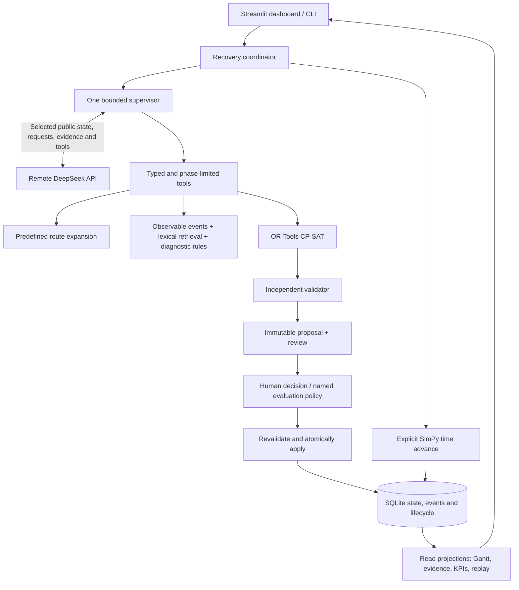

# Architecture and responsibility boundaries

ShopfloorPilot is a local Python application demonstrating an engineering workflow
over synthetic manufacturing data. One Streamlit process hosts the dashboard and
local services; CLI workflows use the same services. SQLite is authoritative. The
only remote inference service is DeepSeek. There is no local LLM, equipment control,
mandatory GPU, HTTP backend service, or multi-agent runtime.

The diagram describes authority, not separate network services. Provider budget and
sanitized trace ledgers use additional local SQLite files. They do not own operational
state. CLI and UI must use separate runtime directories when independent demonstrations
are intended.

## What each component does

| Component | Actual responsibility | Implementation |
| --- | --- | --- |
| Process planning | Resolve supported products and aliases; expand every order unit into a predefined operation chain with catalog capabilities and durations. Reject unsupported routes and invented parameters. | [routes.py](../../src/shopfloor_pilot/planning/routes.py), [catalog](../../scenarios/templates/catalog.json) |
| DeepSeek supervisor | Interpret request spans, select permitted evidence tools, request solving/validation, and submit supportable claims with references. Tool choices narrow as required evidence becomes available. | [workflow.py](../../src/shopfloor_pilot/agent/workflow.py), [typed tools](../../src/shopfloor_pilot/tools/supervisor_tools.py) |
| Evidence and diagnosis | Retrieve eleven original synthetic notes lexically; combine persisted observable signals with rule-based hypotheses and resolvable citations. Missing/conflicting evidence stays explicit. | [retrieval](../../src/shopfloor_pilot/retrieval/lexical.py), [diagnostics](../../src/shopfloor_pilot/diagnostics/service.py) |
| CP-SAT | Choose machine assignments/start times under the modeled hard constraints and optimize weighted tardiness, then makespan. | [solver.py](../../src/shopfloor_pilot/scheduling/solver.py) |
| Independent validator | Re-derive route, identity, history, calendar, precedence, capacity, duration, horizon and objective checks without trusting solver output. | [core.py](../../src/shopfloor_pilot/validation/core.py) |
| Coordinator/services | Pin decision state, pause ordinary advances, enforce human or explicit batch approval, reject stale/hash-mismatched candidates, and apply exactly once. | [coordinator.py](../../src/shopfloor_pilot/workflows/coordinator.py), [application.py](../../src/shopfloor_pilot/services/application.py) |
| Simulation and persistence | Rebuild SimPy execution from durable state, apply explicit interventions and advances, preserve completed work, append events/checkpoints transactionally. | [runtime.py](../../src/shopfloor_pilot/simulation/runtime.py), [repository.py](../../src/shopfloor_pilot/storage/repository.py) |
| Dashboard and evaluation | Read the same authority, compare schedules/KPIs, inspect evidence/trace/cost, export replay; separately score every planned evaluation row. | [UI](../../src/shopfloor_pilot/ui/app.py), [collector](../../src/shopfloor_pilot/evaluation/collector.py) |
| Factory twin view | Read-only playback of committed event groups as a 3D/2D factory scene with synchronized machine cards and an end-of-playback check against stored state. No write path. | [factory_twin.py](../../src/shopfloor_pilot/ui/factory_twin.py), [design](factory_twin.md) |

The OpenAI Python package is an HTTP client for DeepSeek's compatible endpoint. It
does not imply OpenAI inference. Selected request text, public state summaries, tool
schemas/results and retrieved evidence leave the local machine for DeepSeek. Credentials
stay in backend memory and are excluded from UI, prompts and committed evidence.

## State, time and approval

Time is integer simulated seconds; intervals are half-open `[start, end)`. Waiting
for a provider or a person never advances simulated time. An explicit advance does.
Decisions are pinned to a run, snapshot/version and decision boundary. At a closed
second `T`, an applicable plan normally starts at `T + 1`; boundary completions are
settled explicitly before opening a decision.

A candidate records its immutable hash, exact order/resource deltas, base snapshot,
version and revision. Creating a proposal or recording approval does not apply it.
Application revalidates and commits approval consumption, authorized deltas, schedule,
events, checkpoint, version change and idempotency result in one SQLite transaction.
Duplicate application returns the existing result. Operational changes invalidate
older proposals; audit/bookkeeping alone does not increment operational version.

Human approval is the interactive default. A named `policy:deterministic` actor is
available only when evaluation explicitly requests it. The supervisor has no approval,
apply, reset, maintenance-confirmation, shell or unrestricted SQL tool. Actor names are
local audit labels, not authentication or proof of who operated the interface.

Completed attempts never change. Unaffected running operations remain fixed and
non-preemptive. A fault interrupts the affected attempt: elapsed work is recorded as
wasted, and a new generation restarts the full duration on a compatible available
machine. The model may recommend maintenance, but only an explicit operator/scenario
confirmation restores capacity. Restoration itself does not apply a new schedule.

## Optimization and metrics

The fixed catalog contains three processing machines, one inspection station and
three product routes. Each standard scenario starts with eight orders. Quantities
expand into individual complete route chains, not a shortened batch duration.

The solver enforces operation precedence, capability compatibility, release times,
availability windows, no overlap, fixed actual history and a finite hard horizon.
Due dates are soft. For horizon `H`, it minimizes
`(H + 1) × sum(weight × max(0, completion − due)) + makespan`; bounded makespan makes
this lexicographic. The delivered evaluation uses a five-second limit, one worker
and a fixed case seed. `FEASIBLE` means a valid incumbent, not proven optimality;
`UNKNOWN` is distinct from infeasibility. Equal incumbent schedules can have different
proof labels near the wall-clock limit.

KPIs are computed from the version-zero checkpoint plus recorded events:

| Metric | Definition and presentation limit |
| --- | --- |
| Weighted tardiness | Sum of priority weight × positive completion-minus-due seconds. Unfinished orders have censored actual values/lower bounds; predictions are labeled separately. |
| Makespan | Latest order completion simulated timestamp. It is an objective value, not provider latency. Actual total remains censored until all orders finish. |
| Utilization | Actual busy seconds divided by calendar capacity in the measured window. Busy includes wasted interrupted work; productive utilization excludes it. No capacity yields an unavailable ratio. |
| Wasted processing | Elapsed time of interrupted attempts, counted once. |
| Recovery | Recorded fault-to-resumption information, with actual/predicted/censored basis. It is not a measured industrial repair time. |
| API latency/cost | Wall-clock/active execution and ledger token charges. Costs are estimates from dated tariffs and provider usage, conservatively reserving unknown usage. |

Detailed definitions and contracts are in [application services and metrics](application_services.md),
[scheduling](scheduling.md), [simulation](simulation.md), and [state/events](state_and_events.md).

## Evidence, recovery and limits

Public observations are allowlisted separately from evaluator-only fault truth and
future interventions. The latter are local scenario inputs, not model evidence.
Retrieval guidance is inert quoted data; citation validation checks IDs, versions,
source/chunk hashes and excerpts. Diagnostic outputs are hypotheses, with uncertainty,
not confirmed causes or remaining-life predictions. Deterministic claim checks cover
selected observable assertions; they do not establish general natural-language truth.

An outage, malformed output, budget exhaustion, no feasible schedule or stale decision
produces a visible pause/refusal without applying an unapproved plan. A deterministic
fallback is separately labeled and does not count as LLM success. Provider/tool budgets
persist across restarts. A supervisor interrupted during execution cannot resume its
in-memory conversation; its orphaned decision must be explicitly cancelled and replaced.

Operational replay reconstructs recorded state and KPIs without a provider or solver.
Lifecycle exports expose historical proposals and decisions for inspection but cannot
reactivate approvals. Reset creates a new run identity and retains the previous run.

The application demonstrates consistent engineering boundaries under synthetic tests.
It is not a calibrated digital twin, a production system or a validated maintenance
diagnostic. S13's accepted 100/100 synthetic live outcomes followed two retained failed
campaigns; phase-specific tool narrowing and deterministic claim guards contributed to the
accepted result. No result shows that the LLM improves the shared solver's schedule.
See [results](../evaluation/results.md) and [limitations](../evaluation/limitations.md).
